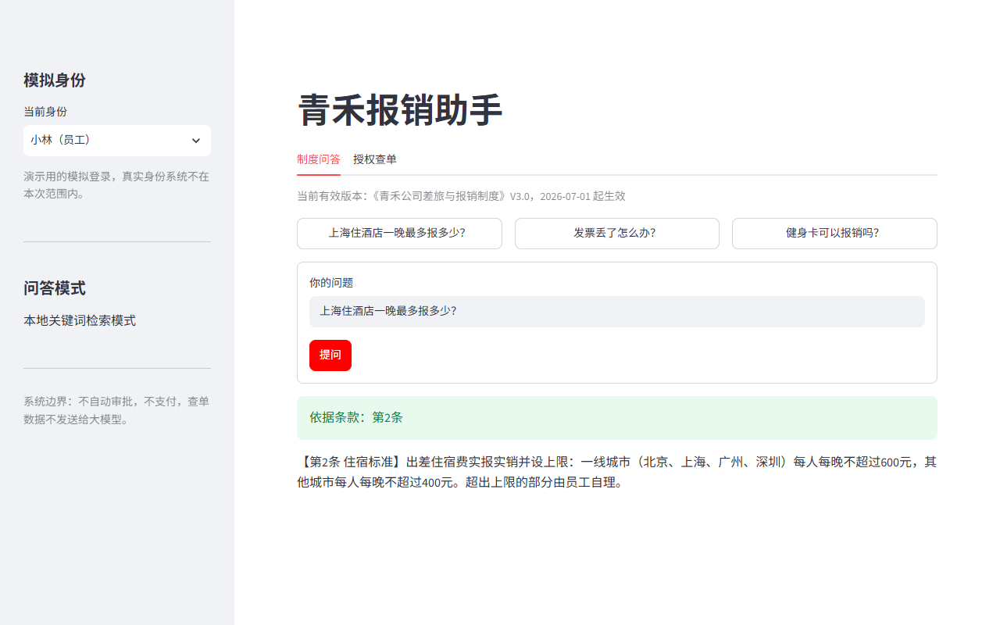
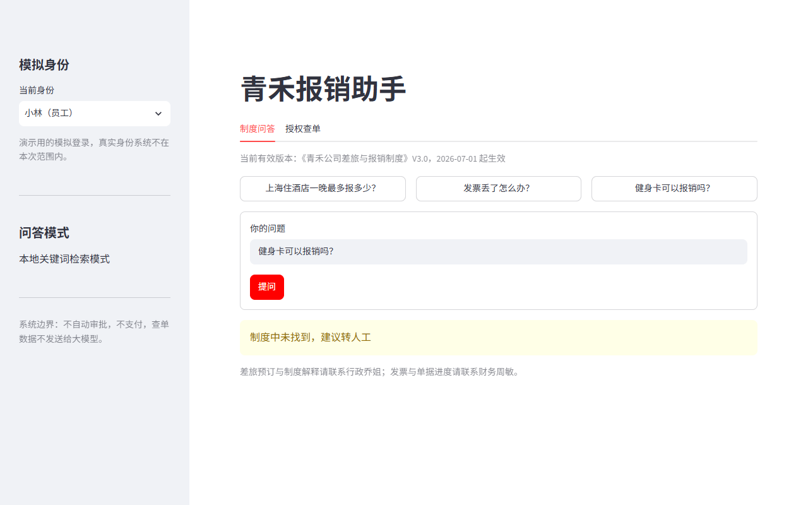
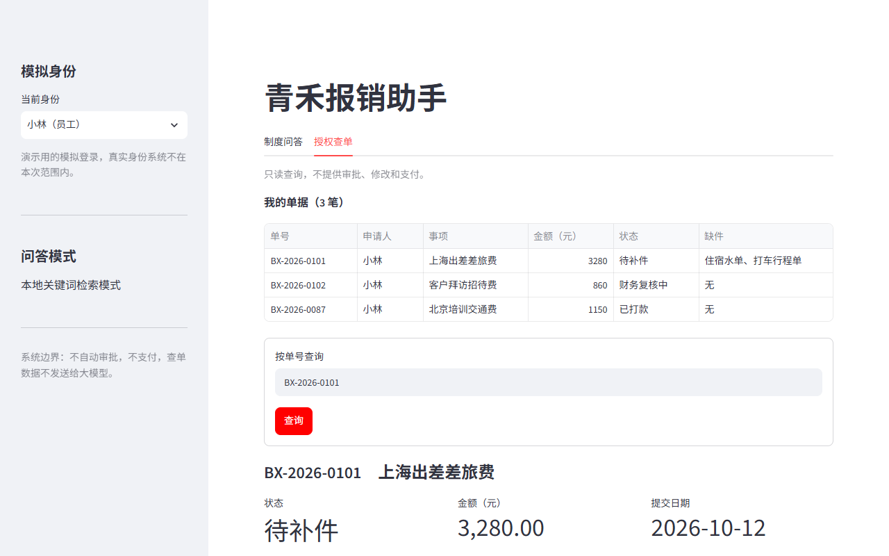
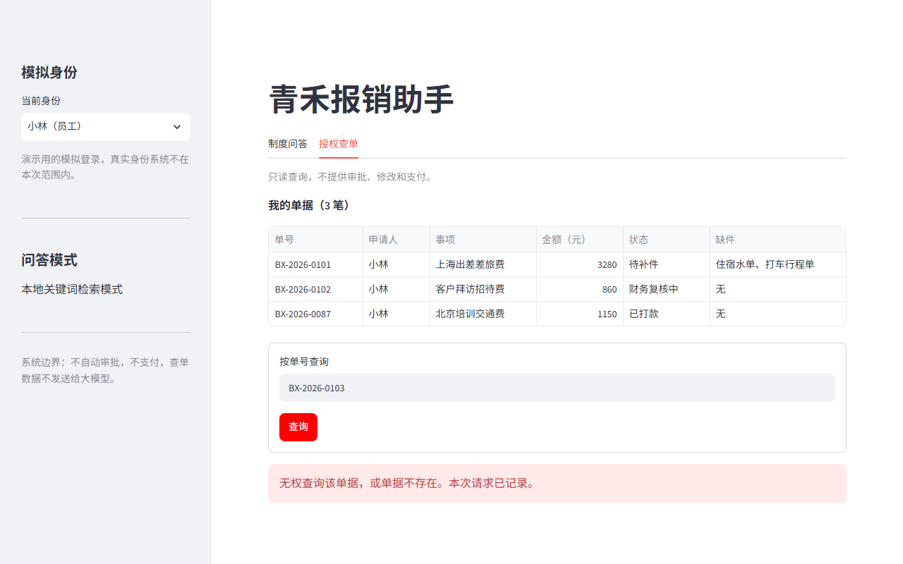
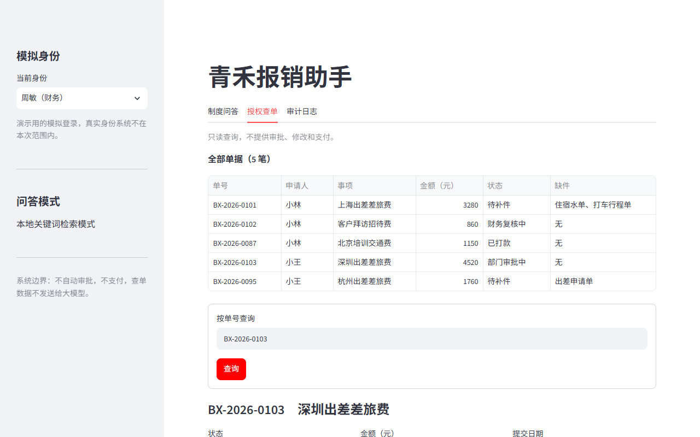
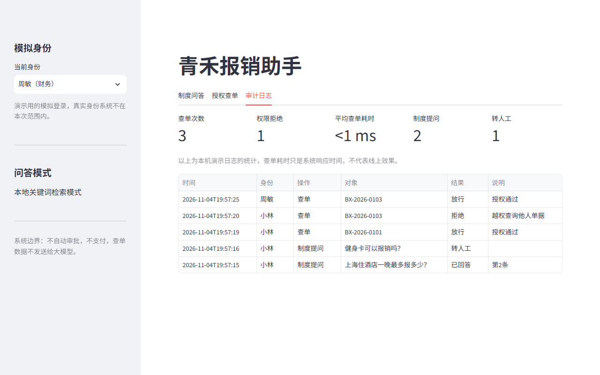

# 青禾报销助手

面向企业员工的报销服务助手（课程训练案例，公司、人物和数据均为虚构）。解决报销制度口径不一致、查单权限和补件信息分散的问题，提供两项能力：

- **有效制度问答**：只依据当前有效版本作答，回答必须标出条款编号；找不到依据时回答“制度中未找到，建议转人工”。
- **授权只读查单**：员工只能查自己的单，越权查询被拒绝并记录日志；财务可查全部。

系统**不自动审批、不支付**。真实身份系统和财务接口不在本次范围内，页面上的身份切换是模拟登录。

## 安装

需要 Python 3.10 及以上版本。以下命令在 Windows PowerShell 中执行：

```powershell
python -m venv .venv
.\.venv\Scripts\Activate.ps1
pip install -r requirements.txt
```

macOS / Linux 把第二行换成 `source .venv/bin/activate`。

## 运行

```powershell
streamlit run src/qinghe/main.py
```

浏览器打开 <http://localhost:8501>。服务只监听本机，因为身份是模拟的。

## 大模型配置（可选）

不配置也能完整演示，断网可用。需要大模型时：

1. 把 `.env.example` 复制为 `.env`（已被 `.gitignore` 排除，不会提交）。
2. 填写 `LLM_API_KEY`、`LLM_MODEL`，非 OpenAI 服务再填 `LLM_BASE_URL`。支持任意 OpenAI 兼容接口。
3. 重启应用，侧边栏会出现大模型开关。

| 情况 | 系统行为 |
| --- | --- |
| 没有 Key 或没有模型名 | 本地关键词检索，直接摘录条款原文 |
| 调用失败（断网、超时、Key 无效） | 本次提问退回本地模式 |
| 回答没有引用、引用错误或金额不符 | 丢弃回答，改为展示条款原文 |
| 检索不到依据 | 不调用大模型，直接转人工 |

查单数据不会发送给大模型。

## 演示步骤

答辩前建议删除 `logs/audit.jsonl`，让日志从零开始。

1. 身份选**小林**，点示例问题“上海住酒店一晚最多报多少？”，再点“提问”：回答引用第2条，金额是 V3.0 的 600 元。
2. 提问“健身卡可以报销吗？”：转人工。
3. 进入“授权查单”，查询 `BX-2026-0101`：看到自己的单据状态和缺件。
4. 查询小王的 `BX-2026-0103`：被拒绝。
5. 身份切到**周敏（财务）**，再查 `BX-2026-0103`：可以查看。打开“审计日志”：能看到第 4 步的拒绝记录。

## 运行截图

截图位于 [docs/screenshots/](docs/screenshots/)。

| 场景 | 截图 |
| --- | --- |
| 制度问答（带引用） |  |
| 找不到依据，转人工 |  |
| 查询本人单据 |  |
| 越权查询被拒绝 |  |
| 财务查看全部 |  |
| 审计日志 |  |

## 测试与评估

```powershell
pytest
python scripts/evaluate.py
python scripts/evaluate.py examples/holdout_questions.yaml
```

`pytest` 共 5 个测试函数（参数化后 17 个用例），覆盖越权拒绝、未知身份、只读和无依据转人工，大模型部分用桩函数验证校验逻辑。

本地模式的评估结果（样本都是作者自拟，规模很小，只能说明 MVP 的行为，不代表真实准确率）：

| 样本 | 引用正确 | 无依据转人工 |
| --- | --- | --- |
| `eval_questions.yaml`（调参时使用） | 20/20 | 8/8 |
| `holdout_questions.yaml`（调参后才运行，未据此修改） | 14/20 | 10/10 |

留出样本里 6 题未通过，全部是有依据却转了人工，没有引错条款。这是有意的取舍：宁可多转人工，也不乱答。所以运行留出样本时脚本会以非零状态退出。

## 目录

```text
src/qinghe/main.py      Streamlit 页面
src/qinghe/core/        制度加载、检索、问答校验、大模型调用、查单权限
src/qinghe/utils/       配置读取、审计日志
data/                   虚构制度（有效 V3.0、已废止 V2.1）、报销单、模拟身份
config/default.yaml     运行参数
examples/               评估样本
scripts/evaluate.py     制度引用准确率评估
tests/                  pytest 测试
docs/                   行业分析、流程图、设计方案、报价单、答辩讲稿要点
logs/                   运行时生成的审计日志（不提交）
```

## 许可证

[MIT](LICENSE)
