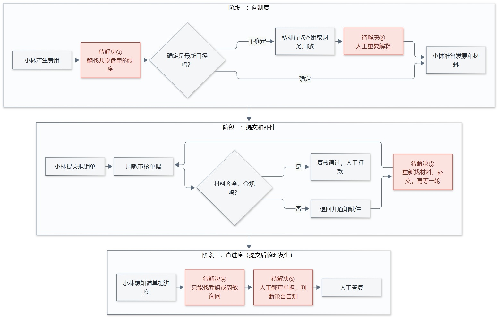
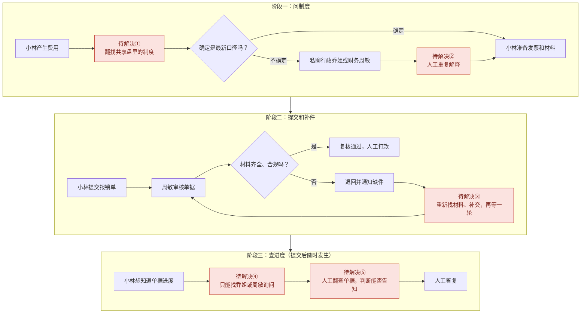

# 现状流程图（没有 AI）

红色节点是待解决的问题，编号对应下表。访谈来自合成场景，依据只能说明问题方向；单量、耗时、退单率都没有统计，属于待采集项。

| 编号 | 待解决问题 | 依据 | 改造后的做法 |
| --- | --- | --- | --- |
| ① | 共享盘里有效、旧版和内部资料混在一起，员工容易找错 | f11 | 只用有效公开制度作答，附来源、版本和原文（F1、S4） |
| ② | 员工来回问行政和财务，人工要重复解释 | 乔姐、小林的访谈记录（待核实） | 常见问题自助解决，答不了才转人工（F1、F7） |
| ③ | 找错材料后要重新补件，再等一轮 | 小林的访谈记录，标注 f11 | 查单时显示缺件；按制度生成材料清单草稿（F4、F6） |
| ④ | 单据进度不透明，只能找人问 | f10、f15 | 只读查询状态、含义和更新时间（F4） |
| ⑤ | 能否告知要靠人工判断，自报姓名也可能被放行 | f42、f54、f55 | 由代码按身份和组织判断权限（F4、S2、S3） |

## 流程图源码

