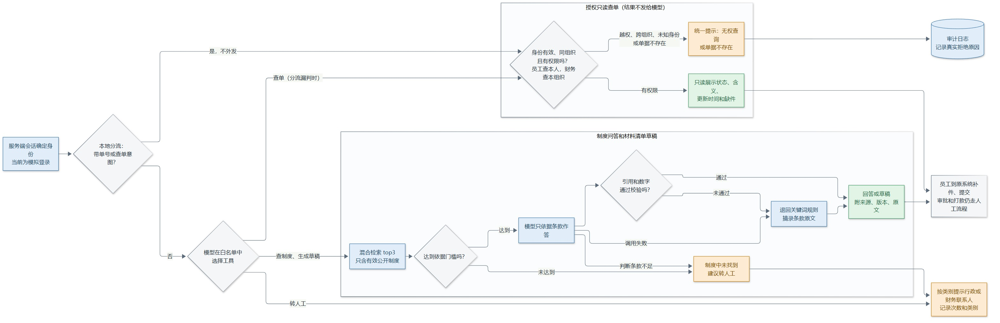
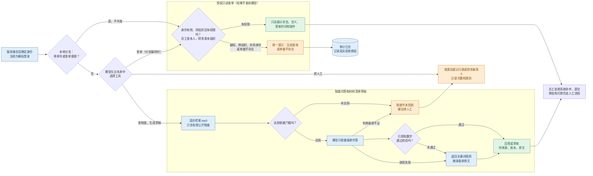

# AI 改造后流程图

这是按[需求清单](07-提示词01-需求清单.md)和[架构方案](08-提示词02-架构方案.md)确定的目标流程。蓝色是系统处理，绿色是给用户的结果，橙色是拒绝或转人工。审批和打款仍由人完成，系统不参与。

**目前的实现情况：**

| 环节 | 状态 |
| --- | --- |
| 查单权限、组织隔离、审计日志 | 已在 Streamlit 页面实现 |
| 本地分流 | 已在命令行原型实现，页面通过单独的查单页实现 |
| 混合检索、依据门槛、回答校验 | 已在命令行原型实现；页面仍用关键词检索 |
| 模型选择白名单工具、生成材料清单草稿、按类别转人工 | 未实现，属于架构方案阶段 2 |
| 服务端会话 | 未实现，属于第一周 FastAPI 骨架；当前是页面上的模拟身份 |

## 流程图源码

