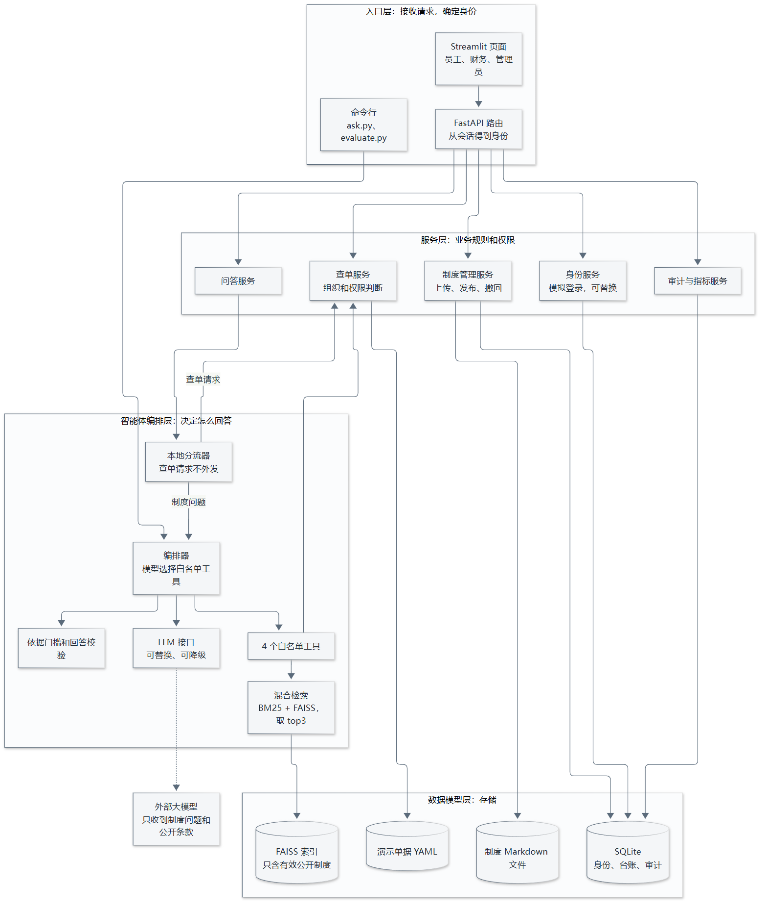
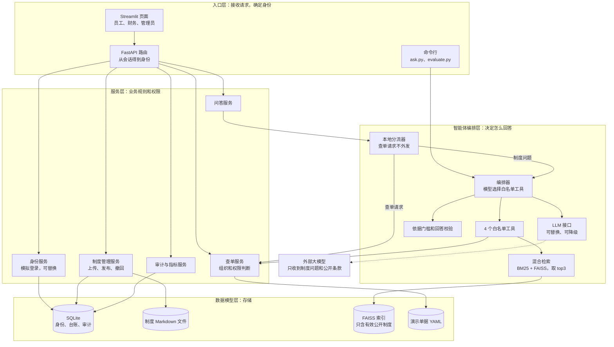
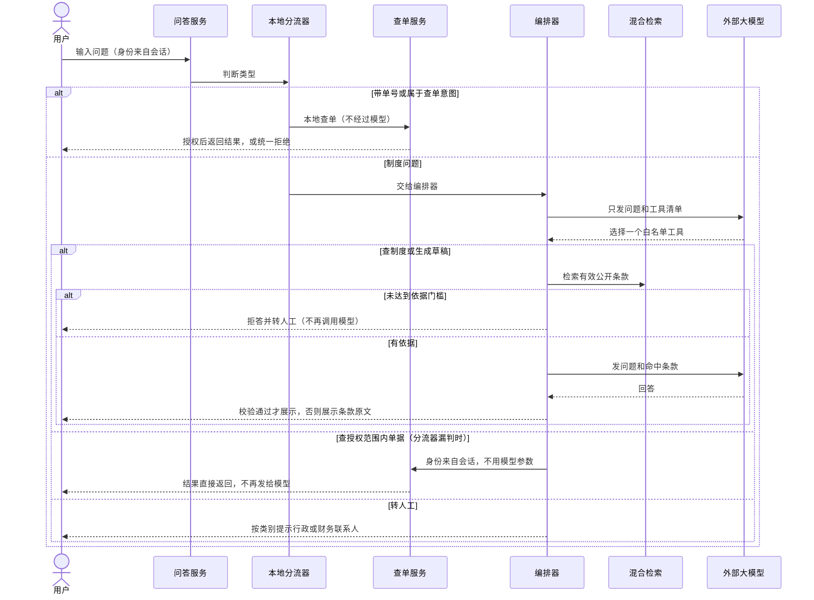

# 提示词 02：报销助手智能体架构方案

本方案只做设计，不含代码。需求编号（F、S、T、A）见[需求清单](07-提示词01-需求清单.md)，事实编号（f）见[访谈记录](01-访谈记录/discovery-report.md)。

**技术约束：** FastAPI（异步）、Python 3.11+、可替换供应商的 LLM API、向量化的制度知识库。

**三条不变的边界：** 不审批、不支付；权限由代码判断，模型不能绕过；单据数据不发给外部模型。

## 一、四层架构





| 层 | 职责 | 不负责 |
| --- | --- | --- |
| 入口层 | 接收请求；由会话确定身份，忽略前端和模型传来的身份 | 业务判断 |
| 服务层 | 权限、制度发布、审计、指标 | 调用模型 |
| 编排层 | 分流、选工具、检索、校验回答、降级 | 判断权限 |
| 数据模型层 | 保存数据和索引 | 业务规则 |

### 一个问题的处理流程



### 四个白名单工具

每个问题最多调用一次工具。工具名不在白名单或参数不合法时，直接转人工。

| 工具 | 模型可以传的参数 | 结果去向 |
| --- | --- | --- |
| 查制度 | 检索关键词 | 校验后作为回答 |
| 查授权范围内单据 | 单号（可选） | **直接给用户，不回传模型** |
| 生成材料清单草稿 | 费用类型 | 校验后作为草稿，只留在当前会话 |
| 转人工 | 问题类别 | 显示联系人，记录次数和类别 |

任何工具都不接受身份参数。查单范围由查单服务按会话身份和组织判断。

### 什么数据会发给外部模型

| 会发送 | 不会发送 |
| --- | --- |
| 判定为制度问题的问题文字 | 单号和单据内容 |
| 工具清单 | 查单结果 |
| 检索命中的有效公开条款 | 内部资料（如 DOC-FIN）、已撤回的制度 |
| | 审计日志、用户编号 |

**残余风险：** 用户可能在制度问题里写个人信息，分流器也可能漏判没写单号的查单请求。措施是分流词表偏保守、用查单问法样本做测试、页面提示不要输入个人信息；侧边栏也可以关闭大模型。

### 依据门槛：怎样保证无依据就拒答

混合检索总能返回 3 条结果，不能把“有结果”当成“有依据”。所以设三道关：

1. **检索门槛：** 相关度低于阈值就拒答，且不调用模型。阈值用样本确定[f03]。
2. **模型判定：** 模型只依据命中条款作答，条款不足时输出固定的拒答语。
3. **回答校验：** 沿用现有规则。引用必须来自本次检索，数字必须出现在被引用的条款里。

现有的“出现制度外词语就拒答”规则（10/10 拒答，但只答对 14/20）作为可配置的严格模式保留。如果第一周发现“酒店的按摩费”这类问题漏过前三关，就打开它。

### 降级方案

| 故障 | 行为 |
| --- | --- |
| 大模型不可用 | 用本地规则选工具，摘录条款原文 |
| 嵌入模型不可用 | 只用 BM25 |
| 两者都不可用 | 使用现有关键词检索 |

查单不依赖模型和网络，不受这些故障影响。

## 二、目录结构

沿用老师模板的 `src/qinghe/`，不移动现有模块。

```text
青禾报销助手/
├── src/qinghe/
│   ├── main.py               [改造] Streamlit 页面，改为调用后端 API
│   ├── __main__.py           [新增] python -m qinghe 一条命令启动前后端
│   ├── api/                  [新增] 入口层
│   │   ├── app.py
│   │   ├── deps.py           从会话取得身份上下文
│   │   └── routes/           auth、chat、claims、drafts、admin、audit
│   ├── services/             [新增] 服务层
│   │   ├── auth.py           登录接口和模拟登录实现
│   │   ├── chat.py
│   │   ├── drafts.py
│   │   ├── policy_admin.py
│   │   └── metrics.py
│   ├── agent/                [新增] 编排层
│   │   ├── router.py         本地分流器
│   │   ├── orchestrator.py
│   │   ├── tools.py          白名单工具
│   │   └── prompts.py
│   ├── core/                 现有模块在此演进
│   │   ├── claims.py         [改造] 权限规则不变，读取单据抽成接口
│   │   ├── policy.py         [改造] 解析 Markdown 制度
│   │   ├── qa.py             [改造] 保留引用校验
│   │   ├── llm.py            [改造] 增加工具选择
│   │   ├── retriever.py      [保留] 关键词检索，作为降级方案
│   │   ├── chunker.py        [新增] 按条款切片
│   │   ├── embeddings.py     [新增] 可配置的嵌入模型
│   │   └── hybrid.py         [新增] BM25 + FAISS 混合检索
│   ├── db/                   [新增] 表模型、连接、演示数据初始化
│   └── utils/                config.py、audit.py [改造]
├── data/
│   ├── policies/             [新增] Markdown 制度
│   ├── claims.yaml           [保留] 演示单据
│   └── users.yaml            [改造] 增加组织和管理员，作为初始化数据
├── storage/                  [新增，不提交] 数据库、FAISS 索引、上传文件
├── scripts/
│   ├── ask.py                [新增] 提示词 03 的命令行入口
│   └── evaluate.py           [改造] 统计样本题和指标
├── examples/                 [新增] 10 道验收样本题
├── tests/                    [扩展] 权限、分流、隔离、降级
├── config/default.yaml       [扩展] 检索阈值、模型、联系人、日志保留期
└── docs/
```

**接口概览：**

| 接口 | 用途 | 可访问角色 |
| --- | --- | --- |
| `POST /auth/login`、`/auth/logout` | 模拟登录，服务端保存会话 | 全部 |
| `POST /chat` | 问答和工具调用 | 全部（管理员不能查单） |
| `GET /claims`、`/claims/{id}` | 只读查单 | 员工、财务 |
| `POST /drafts` | 生成材料清单草稿，不落库 | 员工、财务 |
| `/admin/policies` | 上传、发布、撤回、查看台账 | 管理员 |
| `GET /audit`、`/metrics` | 审计和指标 | 财务（完整）、管理员（脱敏），都限本组织 |

系统不提供审批、支付、修改单据的接口。

## 三、数据库表设计

单机部署，使用 SQLite。外键和索引在实现时补全。

| 表 | 关键字段 | 约束和说明 | 需求 |
| --- | --- | --- | --- |
| `organizations` | id、name | 青禾总部、青禾华南 | S3 |
| `users` | id、org_id、name、role | role 为员工、财务、管理员 | S1 S3 |
| `auth_sessions` | token_hash、user_id、created_at、expires_at | 只存令牌哈希，身份只从这里取 | S2 |
| `policy_documents` | id、code、title、category、org_id、maintainer_id | org_id 为空表示全公司适用 | F8 |
| `policy_versions` | id、document_id、version、file_path、file_sha256、effective_from、effective_to、scope、visibility、status、reviewer_id、published_at、withdrawn_at | 同一制度只能有一个已发布版本；visibility 默认内部 | F8 F9 S4 |
| `policy_chunks` | id、version_id、clause_no、title、text、keywords、vector_id | 按条款切片，单片不超过 500 字 | F1 F2 |
| `policy_events` | id、version_id、action、actor_id、at、note | 发布、撤回都留痕，只追加 | F8 |
| `policy_conflicts` | id、chunk_a_id、chunk_b_id、status、marked_by、note | 命中未解决的冲突条款时，拒答并转人工 | F9 |
| `audit_events` | id、at、org_id、action、actor_id、claim_id、result、reason、mode、citations、category、elapsed_ms | 字段白名单，默认保留 90 天 | S5 A1 |
| `claims`（预留） | id、org_id、owner_id、title、amount、status、updated_at、missing | 现阶段不建表，导入财务文件时启用 | T4 |

**有意不设的表：**

- **对话和消息表：** 不保留问题原文[f44]。
- **草稿表：** 草稿只留在当前会话，不写入业务系统。
- **审批和支付表：** 超出项目边界。

**审计可见范围：**

| 字段 | 财务（本组织） | 管理员（本组织） |
| --- | --- | --- |
| 时间、操作、结果、原因、模式、引用条款、类别 | 可见 | 可见 |
| 身份编号、单号 | 可见 | **隐藏** |

**制度状态：** 草稿 → 已发布 → 已撤回。发布时必须记录审定人。

- **发布：** 校验同一制度没有其他已发布版本，切片后重建索引，再原子替换旧索引。
- **撤回：** 先改状态，检索时再按状态过滤一次，所以索引重建完成前已撤回的内容也不会被使用。
- **内部资料：** 无论是什么状态，都不进索引[f22]。

## 四、第一周最小验证目标

**目标：** 证明最有风险的三件事可行：混合检索能答对、无依据能拒答、查单和内部资料不会外发。

| 天 | 任务 | 通过标准 |
| --- | --- | --- |
| 1 | 建分支；把 V3.0 制度转成 Markdown；按条款切片 | 15 条条款都能切出，单片不超过 500 字；现有 21 个用例仍通过 |
| 2 | BM25 + FAISS 混合检索，只索引有效公开制度 | top3 能命中样本题的依据；索引里没有 DOC-FIN 和已废止版本 |
| 3 | `scripts/ask.py` 命令行问答，调用可配置的 LLM | 命令行问题能得到带条款引用的回答 |
| 4 | 防护开关和拒答实验 | **关闭防护：** 记录模型面对制度外问题的真实回答。**打开防护：** 同样的问题全部转人工 |
| 5 | 本地分流器和工具选择验证 | 带单号和查单问法的输入不触发外部调用；实测 DeepSeek 能从白名单中选对工具 |
| 6 | FastAPI 骨架：模拟登录和查单 | 身份来自会话；请求里伪造身份无效；越权和跨组织 100% 拒绝 |
| 7 | 跑 10 道样本题，断网复测 | 10 题全部答对；断网时退回关键词检索；写出验证记录 |

**第一周不做：** 制度后台、草稿工具、Streamlit 改造、审计迁移数据库。

**后续阶段：**

| 阶段 | 内容 | 对应需求 |
| --- | --- | --- |
| 2 | 完整智能体编排：四个工具、转人工类别、草稿 | F3 F6 F7 |
| 3 | 数据库、制度后台、审计迁移、脱敏视图、日志清理 | F8 F9 S1 S5 |
| 4 | Streamlit 改为调用 API，一条命令启动，四个指标统计 | T6 A1 A2 |

## 五、需求到架构的对应

| 需求 | 架构位置 | 阶段 |
| --- | --- | --- |
| F1 依据制度作答，无依据拒答 | `agent/orchestrator`、`core/qa`、依据门槛 | 第一周 |
| F2 按条款切片和混合检索 | `core/chunker`、`core/hybrid`、`policy_chunks` | 第一周 |
| F3 受控智能体 | `agent/orchestrator`、`agent/tools` | 第一周验证，阶段 2 完成 |
| F4 查单权限 | `core/claims`、`routes/claims` | 第一周 |
| F5 本地分流和结果直出 | `agent/router`、`agent/tools` | 第一周 |
| F6 材料清单草稿 | `services/drafts`、`routes/drafts` | 阶段 2 |
| F7 转人工 | 转人工工具、`config/default.yaml`、`audit_events.category` | 阶段 2 |
| F8 制度后台 | `services/policy_admin`、`policy_*` 表 | 阶段 3 |
| F9 制度冲突拒答 | 发布校验、`policy_conflicts` | 阶段 3 |
| S1 三种角色 | `users.role`、`routes/audit`、审计可见范围 | 第一周起，阶段 3 完成 |
| S2 模拟登录和服务端会话 | `services/auth`、`api/deps`、`auth_sessions` | 第一周 |
| S3 两个组织隔离 | `organizations`、`can_read` | 第一周 |
| S4 只索引有效公开制度 | `core/hybrid` 入库过滤、检索时状态过滤 | 第一周 |
| S5 审计最小化 | `utils/audit` 字段白名单、`audit_events` | 已有，阶段 3 迁移 |
| T1 模型可替换和降级 | `core/llm`、`core/retriever` | 第一周 |
| T2 嵌入可配置 | `core/embeddings`、配置 | 第一周 |
| T3 单机运行，单据不离开本地 | 部署方式、外发边界 | 第一周 |
| T4 静态单据和导入接口 | `core/claims` 的读取接口、`claims` 预留表 | 第一周 |
| T5 命令行入口 | `scripts/ask.py`、`scripts/evaluate.py` | 第一周 |
| T6 FastAPI 后端和 Streamlit 页面 | `api/`、`main.py`、`__main__.py` | 第一周起，阶段 4 完成 |
| A1 四个指标可统计 | `services/metrics`、`scripts/evaluate.py` | 阶段 4 |
| A2 验收样本和拒绝率 | `examples/`、`tests/` | 第一周 |

## 六、决策记录

**你已决定：**

| 编号 | 决定 |
| --- | --- |
| D1 | 本地代码先分流，查单请求不外发 |
| D2 | 新增第 4 个工具“生成材料清单草稿” |
| D3 | 工具改名为“查授权范围内单据”，范围由代码判断 |
| X1 | 新增 FastAPI 后端，Streamlit 改为调用它的页面 |
| X2 | 保留员工、财务、管理员三个角色 |
| X3 | 按条款切片，单片不超过 500 字 |
| X4 | 命令行脚本设防护开和关两种模式 |
| X5 | 一个命令行入口脚本，调用 `src/qinghe` 的可复用模块 |

**这一步按建议处理的小冲突和选型：**

| 编号 | 决定 | 理由 |
| --- | --- | --- |
| R1 | 用 `python -m qinghe` 一条命令启动前后端 | X1 后有两个进程，这样保留“一条命令启动”的要求 |
| R2 | 默认嵌入模型用本地的 `BAAI/bge-small-zh-v1.5`（fastembed，约 90 MB） | 问题不用再发给另一家服务，运行时可断网；首次需要联网下载一次，且可通过配置更换 |
| R3 | BM25 用 rank-bm25 和 jieba，向量库用 faiss-cpu | 已确认能在本机 Windows 和 Python 3.12 上解析安装 |
| R4 | 工具选择用模型的工具调用（`tools` 参数），换供应商不支持时改为让模型输出 JSON；两种方式都由代码校验 | [DeepSeek 文档](https://api-docs.deepseek.com/guides/tool_calls)确认支持，示例用 `deepseek-flash`；严格模式是 Beta，不依赖它 |
| R5 | 每个问题最多调用一次工具 | 没有多步需求，限制越严越容易验证 |
| R6 | 演示单据继续用 YAML，`claims` 表只预留 | T4 要求静态数据，现在建表没有用处 |
| R7 | 审计日志现阶段仍用 JSONL，阶段 3 迁移到 SQLite，接口不变 | 按组织过滤和 90 天清理需要数据库，第一周用不到 |
| R8 | 财务和管理员的审计视图都限本组织，财务继续看完整字段 | 这是 S3 组织隔离的延伸，只收紧权限，没有放宽 |
| R9 | 上传只接受 Markdown，可见范围默认内部 | 默认不进检索，防止内部资料误入[f22] |
| R10 | 跨制度冲突由管理员标记，系统不自动做语义判断 | 自动判断容易误报，也不可靠；同一制度的版本冲突由发布校验拦截 |
| R11 | 10 道验收题为 6 道有依据、4 道无依据，新写一批 | 现有样本已用于调参，新题更能反映实际水平 |
| R12 | 演示数据增加乔姐（管理员）和青禾华南的员工、财务 | S1、S3 的演示需要这些身份 |
| R13 | `05-项目设计方案.md` 里向量检索原是“放弃的方案”，实现混合检索时已改成现行方案 | 这是你在 Q8 做的决定，文档应跟实际实现同步 |

## 七、风险和未验证事项

| 风险 | 影响 | 应对 |
| --- | --- | --- |
| 语义检索让制度外问题也“看起来相关” | 模型可能基于不相干条款作答 | 三道关；第 4 天做拒答实验；必要时打开严格模式 |
| 分流器漏判查单请求 | 问题文字外发（单据内容仍不外发，因为查单结果不回传模型） | 分流词表偏保守；用查单问法样本测试 |
| DeepSeek 工具调用只看过文档，没有实测 | 模型可能选错工具或参数不合规 | 第 5 天实测；选错或参数不合规时转人工 |
| 嵌入模型需要首次下载 | 断网环境首次无法使用 | 提前下载并缓存；不可用时退回 BM25 |
| 依赖变多（新增约 23 个包） | 安装时间和体积增加 | 分阶段引入；第一周只装所需的包 |
| 模拟登录不是真实认证 | 仍不满足“已认证身份”[f42] | 只监听本机；保留登录接口，以后可接单点登录 |
| 指标数据不完整 | 人工转接的时长和单价、员工等待时间都测不到 | 标为待采集，不预填[f03] |
| 访谈事实是合成假设 | 真实企业的情况可能不同 | 裁决人、日志保留期等标为待确认 |
