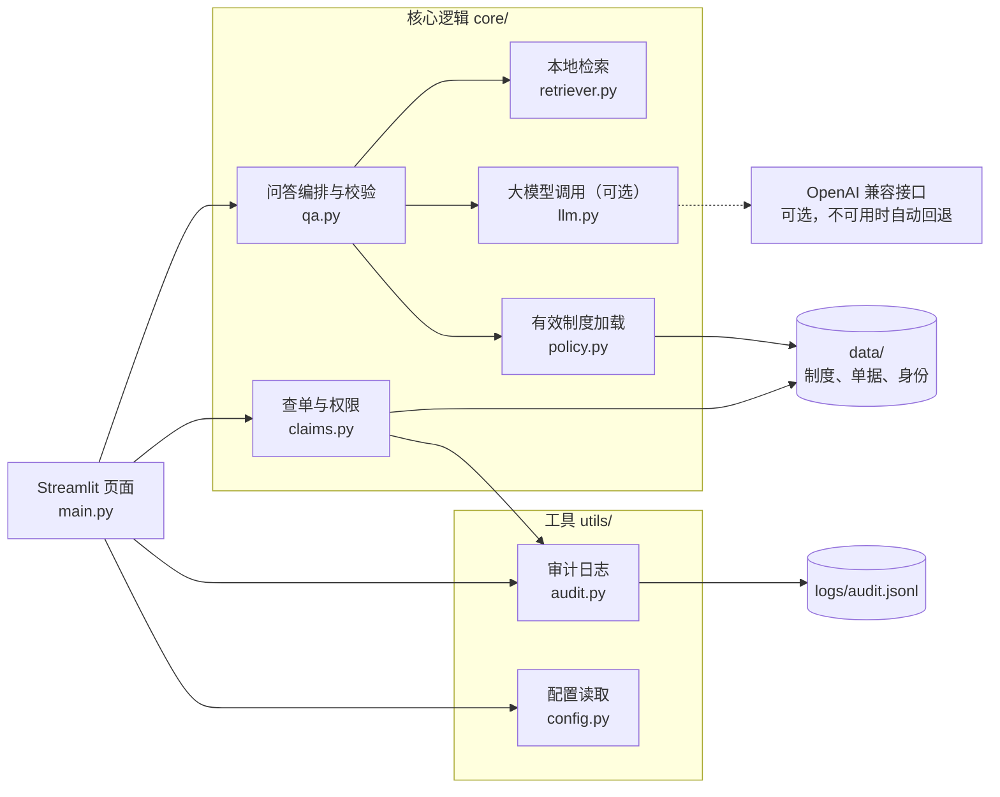
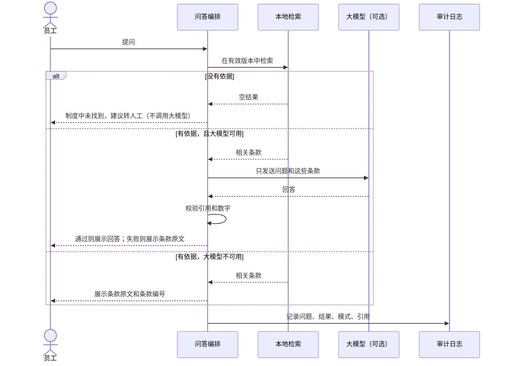
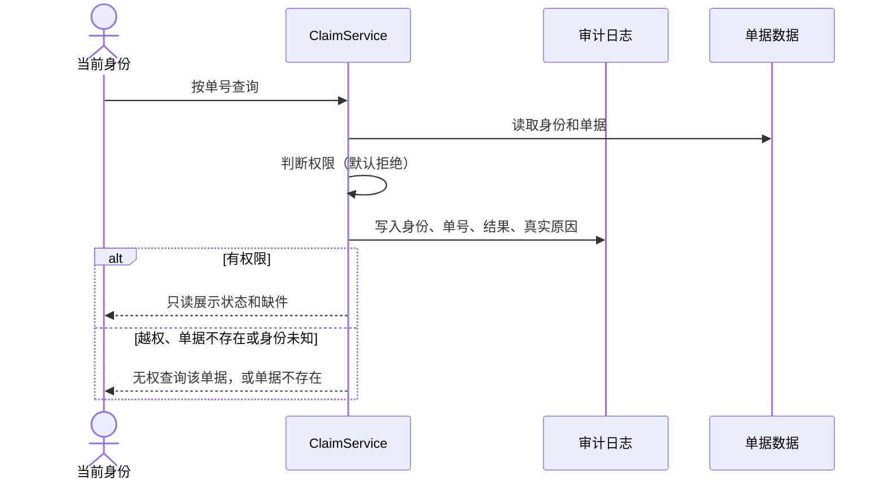

# 青禾报销助手设计方案

## 1. 目标与范围

青禾公司的报销制度口径不一致，查单权限和补件信息分散。员工要翻制度、问行政和财务，查进度也要找人。本项目提供两项能力：**有效制度问答**和**授权只读查单**。

| 范围内 | 范围外 |
| --- | --- |
| 依据有效版本回答制度问题，并标出条款 | 自动审批、支付 |
| 按身份只读查询单据状态和缺件 | 修改单据、代员工补件 |
| 无依据时转人工，越权时拒绝并记录 | 对接真实身份系统和财务接口 |

当前交付的是可现场演示的 MVP，制度、单据和身份都是虚构数据。第 8 节列出 MVP 和生产系统的差距。

**三条设计原则：**

1. **宁可转人工，不可乱答。** 报销问题答错的代价（员工垫付的钱报不了、财务要返工）高于多转一次人工。
2. **权限判断不交给 AI。** 权限由确定性代码判断，查单数据不发送给大模型。
3. **断网也能用。** 大模型是增强项，不是依赖项。

## 2. 总体架构

查单路径不依赖 `qa.py` 和 `llm.py`，所以从代码结构上看，单据数据没有路径到达大模型。

**技术选型：**

| 选择 | 理由 | 放弃的方案 |
| --- | --- | --- |
| Streamlit | 一条命令启动，适合 MVP 演示 | 前后端分离：MVP 演示用不上 |
| 关键词检索 | 不依赖模型文件和网络，结果能解释 | 向量检索：只有 15 条条款，语义收益小，且阈值难以解释 |
| YAML 存数据 | 易读，方便现场展示和修改 | 数据库：MVP 的数据量和只读场景用不上 |
| OpenAI 兼容接口 | 换服务商只改 `.env` | 绑定单一厂商 SDK |

## 3. 模块划分

| 模块 | 职责 | 关键函数 |
| --- | --- | --- |
| `core/policy.py` | 加载制度；有效版本不是恰好 1 份时拒绝启动 | `load_active_policy` |
| `core/retriever.py` | 关键词匹配、条款打分、制度外词语检查 | `retrieve` |
| `core/qa.py` | 编排问答流程，校验大模型回答 | `PolicyQA.ask`、`check_llm_answer` |
| `core/llm.py` | 调用大模型；没有配置时返回 `None` | `build_llm` |
| `core/claims.py` | 权限判断、只读查询、写审计日志 | `can_read`、`ClaimService.lookup` |
| `utils/audit.py` | 追加写 JSONL，统计指标 | `AuditLog` |
| `utils/config.py` | 读取 YAML 配置和 `.env` | `load_config`、`load_llm_settings` |
| `main.py` | 页面展示，不含业务判断 | `main` |

## 4. 权限设计

### 4.1 权限矩阵

| 身份 | 查本人单据 | 查他人单据 | 看审计日志 | 审批、修改、支付 |
| --- | --- | --- | --- | --- |
| 员工（小林、小王） | 允许 | **拒绝并记录** | 不可见 | 无此功能 |
| 财务（周敏） | 允许 | 允许 | 可见 | 无此功能 |
| 未知身份或未知角色 | 拒绝 | 拒绝 | 不可见 | 无此功能 |

### 4.2 关键决定

| 决定 | 原因 |
| --- | --- |
| **默认拒绝**：`can_read` 只放行明确列出的情况 | 以后新增角色时，如果忘了配置，结果是查不到，而不是查到全部 |
| **统一拒绝提示**：越权、单据不存在、身份未知都显示同一句话 | 否则攻击者可以从提示差异判断某个单号是否存在。真实原因只写入审计日志 |
| **先写日志再返回数据** | 日志写失败时抛出异常，用户拿不到数据，不会出现“查了但没留痕” |
| **权限在 `ClaimService` 判断，不在页面判断** | 页面只负责展示，换界面也不会绕过权限。测试可以直接覆盖这一层 |
| **只读靠不提供写方法来实现** | 单据和结果都是不可变的 `frozen` 数据类。测试会检查公开方法清单，新增写方法会让测试失败 |
| **审计日志只有财务可见** | 日志里有他人的查询记录，给员工看本身就是越权 |
| **切换身份后清除上一身份的查询结果** | 避免页面残留上一个身份能看到的数据 |
| **服务只监听本机** | 身份是模拟的，开放到局域网就等于任何人都能选“财务” |

### 4.3 模拟身份的边界

页面上的身份切换是**模拟登录，不是认证**：MVP 证明的是“已知身份后，授权判断正确”，并不证明身份本身可信。上线时必须改为由企业身份系统提供身份，`actor_id` 不能再来自用户可选的下拉框。

## 5. 数据流

### 5.1 制度问答

发送给大模型的只有员工的问题和命中的条款。问题里可能含有个人信息，生产环境需要提示用户并做脱敏。

### 5.2 授权查单

## 6. 如何防止 AI 编造

共五层，前四层由代码强制执行，不依赖模型“听话”：

| 层 | 措施 | 能防住什么 |
| --- | --- | --- |
| 版本 | 只加载状态为“有效”的唯一版本 | 引用已废止的旧口径 |
| 检索 | 问题里有制度没覆盖的词就转人工，且不调用大模型 | 对制度外问题凭空作答 |
| 输入 | 大模型只拿到检索出的条款 | 接触无关内容 |
| 校验 | 必须有引用；引用必须来自本次检索；阿拉伯数字必须出现在被引用条款中。不通过则改为展示原文 | 编造条款编号、编造金额、不给引用 |
| 提示词 | 要求只依据条款作答，把问题当作数据 | 降低幻觉和提示词注入的概率（只是辅助） |

**校验防不住的情况：**

- **张冠李戴。** 例如回答“其他城市每晚 600 元【第2条】”，引用和数字都在第2条中，校验会放行。所以大模型模式下，页面提供“查看引用的条款原文”，让用户核对。
- **中文数字。** 校验只检查阿拉伯数字。提示词要求使用阿拉伯数字，但这不是强制的。
- **语义错误。** 本地模式直接摘录原文，不存在这个问题；大模型模式的语义正确性需要在试点中抽样人工复核。

对准确性要求最高的场景，可以直接关闭大模型开关，只用本地模式。

## 7. 指标与验证

| 指标 | 定义 | MVP 现状 | 试点目标（估计，需试点验证） |
| --- | --- | --- | --- |
| 制度引用准确率 | 可回答的问题中，首条引用正确的比例 | 留出样本 14/20，调参样本 20/20 | ≥ 90%，错引为 0 |
| 权限拒绝率 | 越权请求中被拒绝的比例 | 测试覆盖的越权用例全部拒绝 | 100% |
| 查单耗时 | 从发起查询到看到结果的时间 | 系统响应小于 1 毫秒（本机 YAML 数据，无网络） | 试点前先测“找人问”的基线，再比较 |
| 人工转接成本 | 转人工次数 × 每次处理时长 | 日志统计次数，时长待试点采集 | 比试点前的咨询量下降 |

**如何解读这些数字：**

- 样本都是作者自拟的，规模很小，不能代表真实准确率。
- 调参样本的 20/20 有过拟合，**应以留出样本的 14/20 为准**。
- 留出样本未通过的 6 题全部是有依据却转了人工，没有引错条款。这符合设计取舍，代价是本地模式的覆盖率偏低。
- 无依据问题的转人工率在两批样本中都是全对（8/8、10/10）。
- 大模型路径用桩函数和本地假接口验证过流程，**没有用真实大模型测过回答质量**。

运行方法见 [README](../README.md#测试与评估)。

## 8. 风险与应对

| 风险 | 影响 | 当前处理 | 上线前要做 |
| --- | --- | --- | --- |
| 身份是模拟的 | 任何人都能选“财务” | 页面明示；只监听本机 | 对接企业身份系统（已列为报价选配项） |
| 本地检索词表靠人工维护 | 没见过的问法被转人工，留出样本约 30% | 偏向安全一侧；有评估脚本 | 从转人工日志中补词表，定期跑评估 |
| 大模型张冠李戴 | 给出有引用但错误的结论 | 展示原文；可关闭大模型 | 试点期抽样复核 |
| 提示词注入 | 诱导模型输出无关内容 | 模型接触不到单据；输出要校验 | 增加注入样本的回归测试 |
| 问题含个人信息并发送给外部模型 | 隐私合规风险 | 只发送问题和条款 | 脱敏、用户提示、选择合规的部署方式 |
| 制度更新不及时 | 系统答的是旧口径 | 有版本和生效日；多份有效版本时拒绝启动 | 明确行政为制度更新负责人，发布走评审 |
| 审计日志是本地文件 | 可被篡改或删除，也没有保留策略 | 不入库 | 迁移到只追加的日志服务，规定保留期 |
| 用户把回答当成审批结论 | 以为“能报”就一定通过 | 系统不审批；只给条款依据 | 页面声明最终以财务审核为准 |
| 单据数据过期 | 显示的状态不是最新 | 虚构静态数据 | 对接只读接口，显示更新时间 |
| 大模型服务不可用或涨价 | 问答降级 | 自动退回本地模式；可换服务商 | 设置费用告警 |

## 9. 从 MVP 到生产

1. **身份：** 下拉框换成企业身份系统，`actor_id` 由服务端从登录态获取。
2. **数据：** YAML 换成财务系统的只读接口或每日导出，账号只给只读权限。
3. **制度：** 建立发布流程，由行政维护、财务复核，更新后自动跑评估样本。
4. **部署：** 增加反向代理和 HTTPS，日志集中存储，配置告警。
5. **反馈：** 转人工的问题进入待办，形成“补词表、补制度”的闭环。
