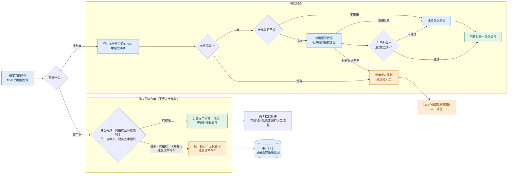

# 青禾报销助手：流程对比

两张图的 PNG 版本：[流程图_现状.png](流程图_现状.png)、[流程图_AI后.png](流程图_AI后.png)。

## 一、现状流程（没有 AI）

红色节点是主要痛点。问题集中在三处：制度口径靠人转述、缺件要来回退补、查进度只能找人。

```mermaid
flowchart TB
    subgraph P1["阶段一：问制度"]
        direction LR
        A["小林产生费用"] --> B["小林翻找报销制度"]
        B --> C{"确定是最新口径吗？"}
        C -- "确定" --> X["小林准备发票和材料"]
        C -- "不确定" --> D["私聊行政乔姐或财务周敏"]
        D --> E["人工重复解释<br/>不同人口径可能不同"]:::pain
        E --> X
    end

    subgraph P2["阶段二：提交和补件"]
        direction LR
        F["小林提交报销单"] --> I["周敏审核单据"]
        I --> J{"材料齐全、合规吗？"}
        J -- "是" --> L["复核通过，人工打款"]
        J -- "否" --> K["退回并通知缺件"]:::pain
        K --> M["小林重新找材料、补交"]:::pain
        M --> I
    end

    subgraph P3["阶段三：查进度（提交后随时发生）"]
        direction LR
        R["小林想知道单据进度"] --> S["找乔姐或周敏询问"]:::pain
        S --> T["周敏人工翻查单据<br/>并判断对方能否知道"]:::pain
        T --> U["人工答复"]
    end

    P1 --> P2
    P2 --> P3

    classDef pain fill:#FBE3E0,stroke:#C0392B,color:#7B241C
```

## 二、加入 AI 后的系统流程

蓝色是助手处理，绿色是可以直接给用户的结果，橙色是拒绝或转人工。审批和打款仍由人完成，助手不参与。每次提问和查单都写入审计日志，财务可以查看。

